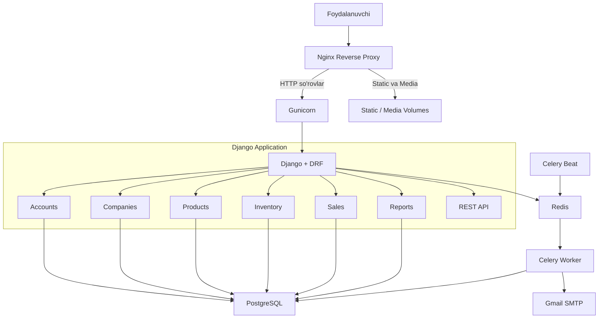
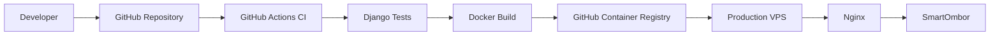

# SmartOmbor — System Architecture

## 1. Umumiy arxitektura



## 2. CI/CD arxitekturasi



## 3. Asosiy modullar

| Modul | Vazifasi |
|---|---|
| accounts | Foydalanuvchilar va autentifikatsiya |
| companies | Kompaniyalar va a'zolik |
| products | Mahsulot va kategoriyalar |
| inventory | Ombor kirim-chiqimi |
| sales | Buyurtmalar va savdo |
| reports | Hisobot va eksport |
| api | REST API va ruxsatlar |
| config | Django va Celery konfiguratsiyasi |

## 4. Ma'lumotlar xavfsizligi

- Foydalanuvchilarning kompaniyalarga a'zoligi tekshiriladi.
- Kompaniyalararo ma'lumotlarga kirish cheklanadi.
- PostgreSQL ma'lumotlar bazasi Docker volume orqali saqlanadi.
- Redis parol bilan himoyalangan.
- Maxfiy sozlamalar `.env` orqali boshqariladi.
- Backup va Restore mexanizmi mavjud.

## 5. Avtomatik vazifalar

Celery va Redis orqali:

- Kam qolgan mahsulotlar haqida Rahbarga xabar yuborish.
- Kunlik savdo hisobotlarini tayyorlash va yuborish.
- Buyurtma yakunlanganda mijozga email yuborish.

## 6. Backup va tiklash

PostgreSQL bazasi va Media fayllar alohida zaxiralanadi.

Linux serverda backup manzili:

`/var/backups/smartombor/`

## 7. Deployment

Production muhiti Docker Compose, Nginx, Gunicorn, PostgreSQL, Redis va Celery asosida ishlaydi.

GitHub Actions orqali Docker image GHCR'ga yuboriladi. VPS mavjud bo'lgach, SSH orqali avtomatik deploy faollashtiriladi.
```

